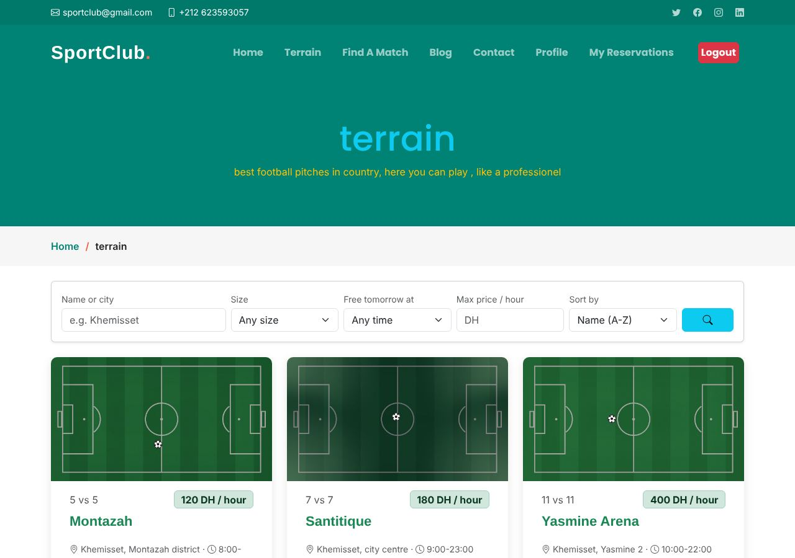
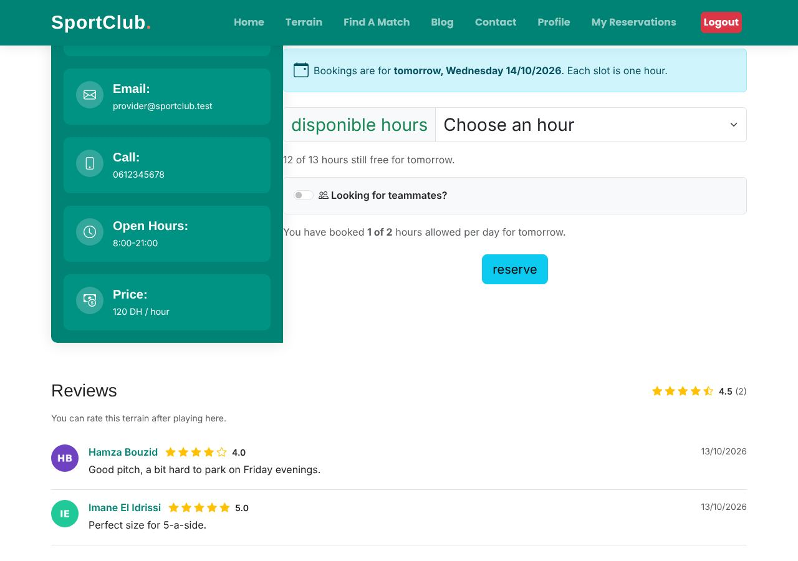
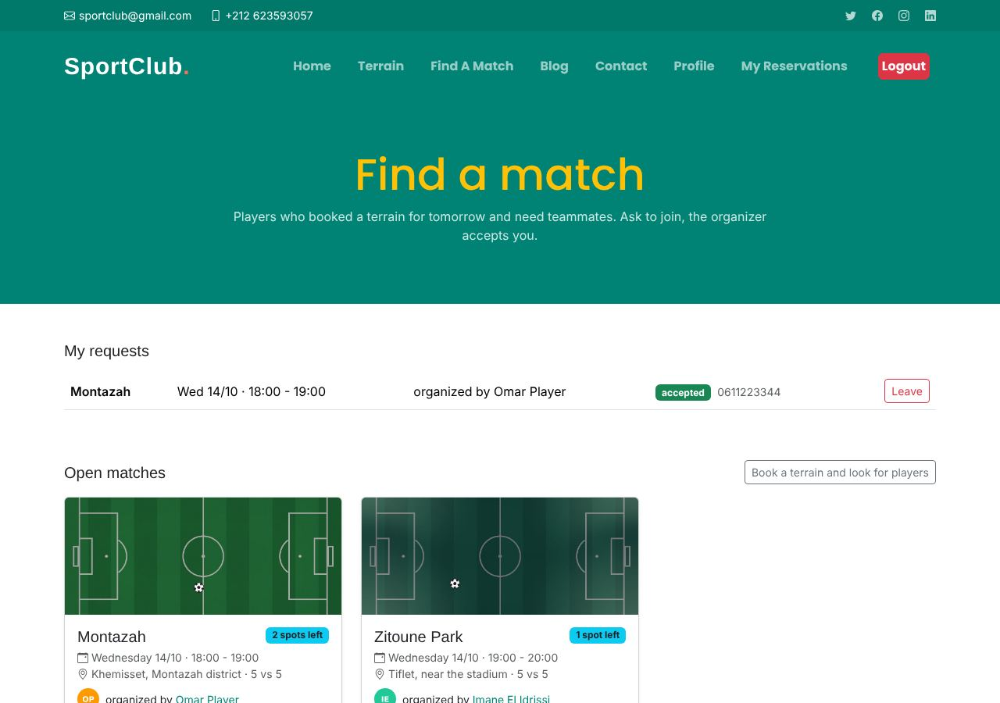
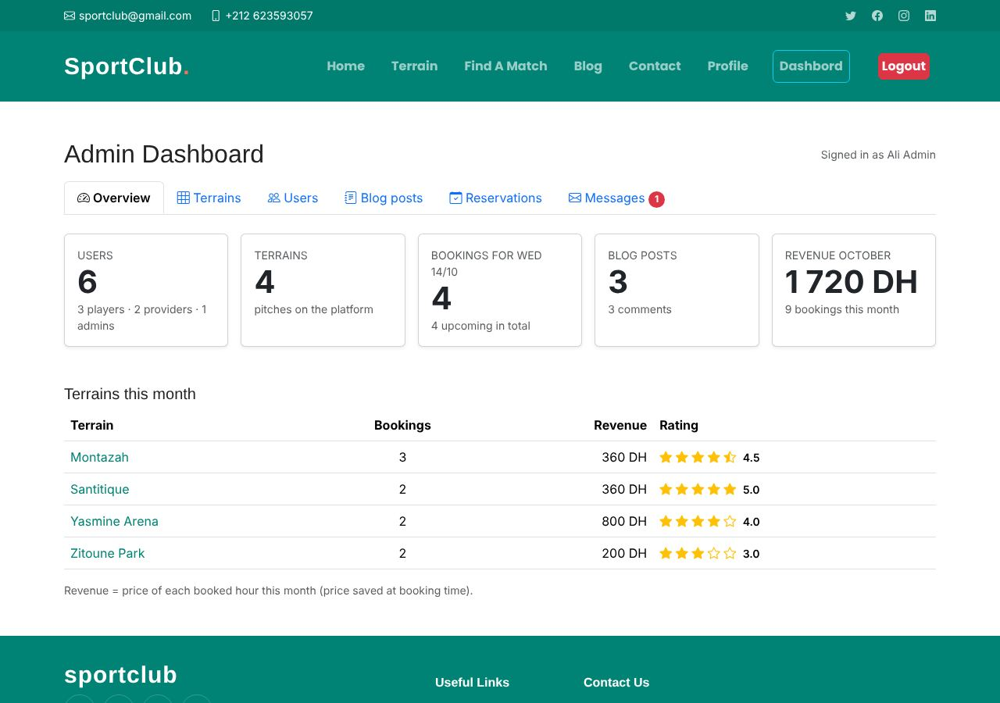

# Sportclub

A full-stack web platform to search local football terrains, reserve match slots, recruit teammates, and engage with the community blog.

[](https://github.com/mostaphabr/Sportclub/actions/workflows/tests.yml)

Built with **Laravel 12** and **Bootstrap 5**.

| Terrains | Booking |
| --- | --- |
|  |  |
| **Find a match** | **Admin dashboard** |
|  |  |

## Features

**Players**
- Search terrains by name or city, size (5 vs 5, 7 vs 7, 11 vs 11), free hour tomorrow, max price; sort by rating or price
- Book a one-hour slot for tomorrow (max 2 hours per day), cancel upcoming bookings
- **Find a match**: look for teammates when booking; other players ask to join, the booker accepts or declines
- Rate a terrain (1 to 5 stars) after playing there
- Blog: publish, edit and delete your posts, comment
- Profile with picture, bio and phone number
- Emails: welcome, booking confirmation, join requests and answers, cancellations

**Providers** (terrain owners)
- See bookings on their terrains, cancel when needed
- Revenue this month and in total, upcoming bookings, ratings

**Admins**
- Dashboard: overview and revenue, terrains (add, edit, delete, price), users (add with a generated password, change role, reset password, delete), blog moderation, all upcoming reservations, messages from the Contact page
- Remove any post, comment or review that doesn't respect the rules

## Getting started

Requirements: PHP 8.2+, Composer, MySQL (XAMPP works), and the PHP extensions `pdo_mysql`, `pdo_sqlite` (for tests), `gd`, `fileinfo`.

```bash
git clone https://github.com/mostaphabr/Sportclub.git
cd Sportclub
composer install
cp .env.example .env          # on Windows: copy .env.example .env
php artisan key:generate
```

Create a MySQL database (for example `SportClub`), set `DB_DATABASE`, `DB_USERNAME` and `DB_PASSWORD` in `.env`, then:

```bash
php artisan migrate --seed    # tables + demo data
php artisan storage:link      # makes uploaded images visible at /storage
php artisan serve             # http://127.0.0.1:8000
```

### Demo accounts

All demo accounts use the password `password`.

| Role | Email |
| --- | --- |
| Admin | admin@sportclub.test |
| Provider | provider@sportclub.test |
| Player | player@sportclub.test |

The demo seeder is for local development only. Don't run it on a real production database.

### Updating an existing installation

After pulling new code:

```bash
composer install
php artisan migrate
php artisan storage:link              # once
```

## Configuration

Values you can set in `.env`:

| Key | Default | What it does |
| --- | --- | --- |
| `SPORTCLUB_MAX_HOURS_PER_DAY` | `2` | Hours a player can book per day (admins are not limited) |
| `SPORTCLUB_CURRENCY` | `DH` | Currency shown next to prices |
| `MAIL_MAILER` | `smtp` | Use `log` while developing: emails are written to `storage/logs/laravel.log` |
| `APP_TIMEZONE` | `UTC` | Timezone for "tomorrow" bookings and dates, e.g. `Africa/Casablanca` |

If the mail server is not configured, bookings still work: the error is logged and the page continues.

## Tests

```bash
php artisan test
```

Tests run on a temporary in-memory SQLite database and a fake storage disk, so they never touch your real data or images. They also run on GitHub Actions for every push (PHP 8.2 and 8.3).

## Project structure

| Path | Contents |
| --- | --- |
| `app/Http/Controllers` | Pages and actions (`ReservationController`, `MatchController`, `ReviewController`, `AdminDashbordController`, `Admin/*` …) |
| `app/Models` | `User`, `Profile`, `Pitche` (terrain), `Reservation`, `MatchRequest`, `Review`, `Post`, `Comment`, `ContactMessage` |
| `app/Policies` | Who can do what (delete a post, cancel a booking, accept a player …) |
| `app/Notifications` | Emails |
| `app/Support/Uploads.php` | Where uploaded images are stored and how their URLs are built |
| `config/sportclub.php` | Business rules (hours per day, currency) |
| `database/seeders/DemoSeeder.php` | Demo data and images |
| `resources/views/SportClub` | Blade views |
| `tests/Feature` | Automated tests |
